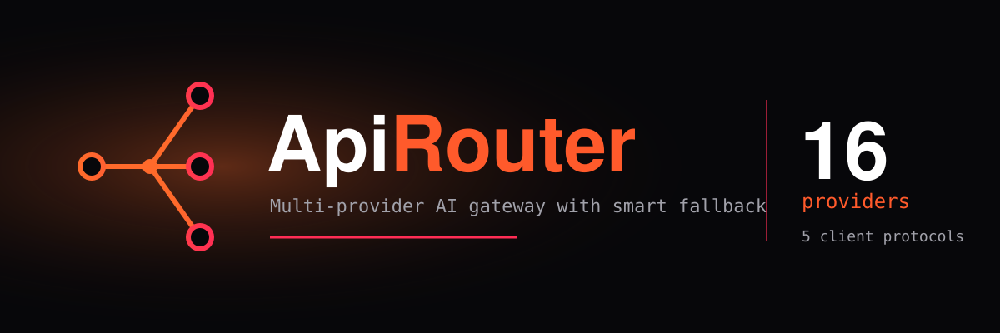

<div align="center">



# ApiRouter

**Multi-provider AI gateway: one endpoint, UI-controlled fallback chain, key rotation and health-aware routing.**


[Features](#features) • [Quick Start](#quick-start) • [Routing](#routing) • [Persistence](#persistence-survive-redeploys) • [API](#api) • [Security](#security)

</div>

---

## Features

- Fallback chain edited in the control panel and followed exactly; every eligible key of a model is tried before the next model.
- Automatic health/latency ordering when no chain is set; last successful provider/model/key is tried first (20 min TTL).
- Model Configurator: declare capabilities per model; requests only reach models that declare what they need.
- Protocols: Claude Messages, OpenAI Responses, OpenAI Chat Completions, Gemini, generic OpenAI-compatible.
- Control panel: health, models, requests, Live Logs, analytics, playground, custom endpoints.

## Quick Start

```bash
git clone https://github.com/mainnetwallet/ApiRouter.git
cd ApiRouter
npm install
cp .env.example .env      # Windows: Copy-Item .env.example .env
# add provider keys to .env
```

```bash
npm run dev:all           # development (UI on http://localhost:5173)
npm run start:all         # production
```

Gateway: `http://localhost:8788`

### Router launcher

```bash
./bin/Router              # Linux / macOS
.\scripts\install-router.ps1   # Windows (once), then run: Router
Router --prod             # production mode
```

## Client Guides

[Claude Code](docs/clients/CLAUDE_CODE.md) · [Codex](docs/clients/CODEX.md) · [Qwen Code](docs/clients/QWEN_CODE.md) · [OpenCode](docs/clients/OPENCODE.md) · [Generic OpenAI](docs/clients/GENERIC_OPENAI.md) · [Other](docs/clients/OTHER_CLIENTS.md) · [Protocols](docs/clients/CLIENTS.md)

## Routing

- **Nothing selected:** automatic health/latency order.
- **Models selected (Configure → Fallback Chain):** your order first, then all unselected models by health; retried once per target after transient failures only.
- Disabled models (Models page Switch) are never tried; no cooldown or health change.
- Sessions: send `X-Multi-AI-Session-ID` to keep the remembered target per session.
- **Reset Fallback** clears remembered targets only.

### Cooldowns

| Failure | Cools down |
|---|---|
| 401 / 402 / 403 | That key + model |
| 400 / 404 / 413 / 422 | That target only |
| 429 | That key + model (`Retry-After`, 5s–12min, default 60s) |
| Other 4xx | That key + model, 1 min |
| 5xx / timeout | That target |

## Persistence (survive redeploys)

Set on hosts with an ephemeral disk (e.g. free Render):

| Variable | Purpose |
|---|---|
| `MODEL_CONFIG_GITHUB_REPO` | `owner/name` |
| `MODEL_CONFIG_GITHUB_TOKEN` | Token with Contents read/write |
| `MODEL_CONFIG_GITHUB_BRANCH` | Data branch (default `main`; use `apirouter-data` to avoid redeploys) |
| `MODEL_CONFIG_GITHUB_PATH` | Default `model-config.json` |
| `CUSTOM_ENDPOINTS_GITHUB_*` | Same for saved custom endpoints (file `custom-endpoints.enc.json`) |
| `CUSTOM_ENDPOINTS_SECRET` | 12+ char passphrase; endpoints are AES-256-GCM encrypted |

`MODEL_CONFIG_GITHUB_*` falls back to `CUSTOM_ENDPOINTS_GITHUB_*`. GitHub is the source of truth on startup; if unreachable, saves return `503`; conflicting saves return `409` (`POST /api/model-config/refresh`).

## API

**Gateway:** `GET /health`, `GET /v1/models`, `POST /v1/messages`, `/v1/responses`, `/v1/chat/completions`, `/v1beta/models/{model}:generateContent`

**Control panel (`/api/*`):** `health`, `health/refresh`, `providers`, `models`, `requests`, `requests/stream`, `fallback` (GET/PUT), `fallback/reset`, `model-config` (GET/POST, `:id` PUT/PATCH/DELETE, `refresh`), `models/switch`, `router/preview`, `analytics`, `config`, `system`, `gateway` (`shutdown`, `resume`), `custom-endpoints`, `playground/custom`

Shutdown pauses the gateway (`503 gateway_paused`); state is kept in `data/gateway-state.json`.

## Custom Endpoints & Playground

- Add saved endpoints under Configure → Custom Endpoints (base URL, API style, models, keys). They become provider `custom-<name>`.
- Playground tests any base URL/key/model without saving. Private/loopback addresses are blocked unless `PLAYGROUND_ALLOW_PRIVATE_HOSTS=1`.
- Declare `image_input` etc. in the Model Configurator to use those capabilities.

## Security

- Keep keys in `.env`; never commit credentials. Keys are never sent to the browser.
- Set `APIROUTER_API_KEYS` for any non-local use. It protects `/v1/messages`, `/v1/responses`, `/v1/chat/completions`, `generateContent`, `count_tokens` and `/api/*`; `/health` and `/v1/models` stay open (restrict at network level if needed).

## Development

```bash
npm run test:ui     # frontend tests
npm run test:all    # full suite
npm run ui:build    # build UI
npm run ui:dev      # UI only
```

## Structure

```text
assets/   Banner
bin/      Router launchers
docs/     Client guides
scripts/  Dev, prod, launcher scripts
src/      Gateway and backend
ui/       React + Vite control panel
```

## License

No license file is included yet.
